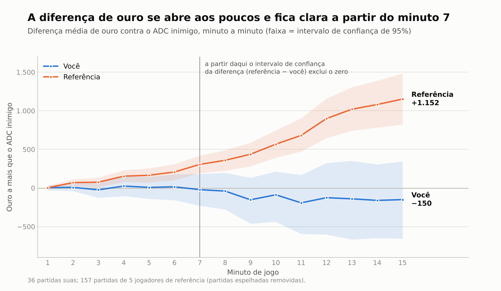
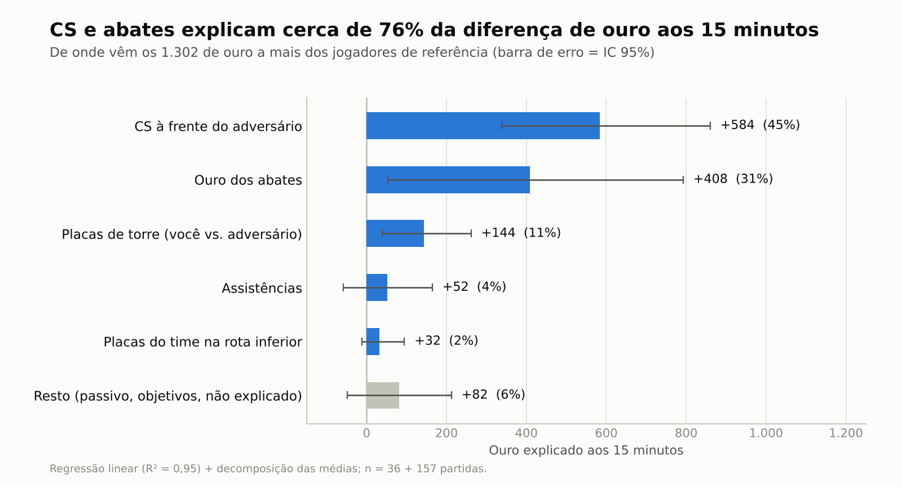
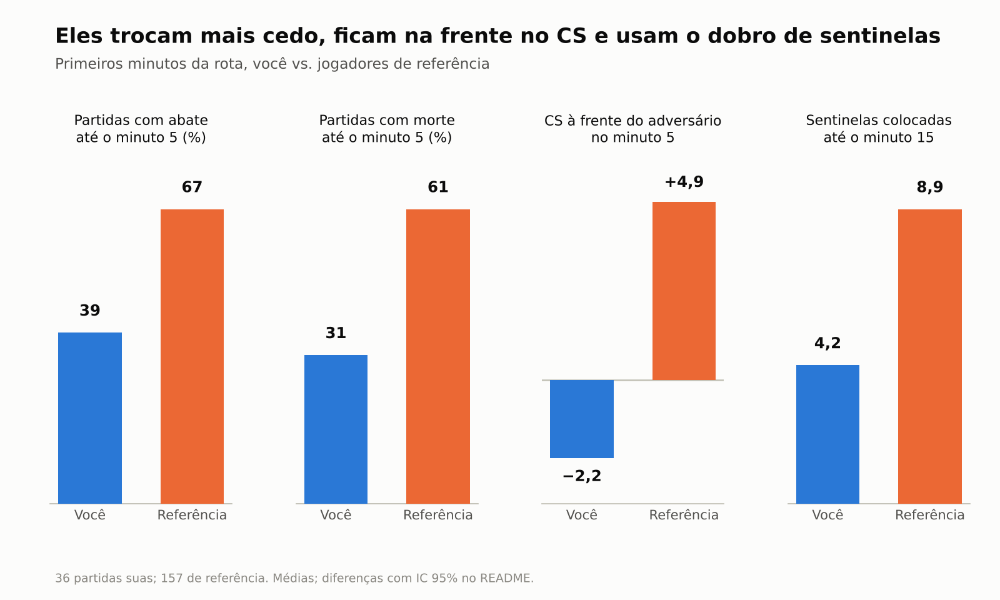

# O que separa o meu ADC de jogadores de elite?

**Benchmark da fase de rota (0–15 min) de League of Legends com a Riot API, Python e SQLite.**

Comparei 36 partidas minhas de ADC com 157 partidas de 5 ADCs de elite do servidor BR para responder uma pergunta: **onde, exatamente, nasce a diferença de ouro entre eles e eu?**



---

## Resumo

| | |
|---|---|
| **Pergunta** | Em que momento e por que a diferença de ouro se abre na rota inferior? |
| **Dados** | Ranqueada Solo/Duo, Riot API (`match-v5` e timelines). Minhas: 36 partidas de ADC (abr–out/2026, 26 delas em setembro). Referência: 157 partidas de 5 ADCs de elite do BR (17/09 a 14/10/2026). |
| **Diferença aos 15 min** | Referência **+1.152** de ouro contra o ADC inimigo; eu **−150**. Diferença: **1.302** (IC 95%: 688 a 1.906). |
| **Quando abre** | Aos poucos, a cerca de 115 de ouro por minuto entre os minutos 5 e 15. O intervalo de confiança da diferença passa a excluir o zero **a partir do minuto 7**. |
| **De onde vem** | **CS (45%) e ouro dos abates (31%)** somam cerca de três quartos da diferença. Placas de torre explicam mais 11%. |
| **Primeiras trocas** | Eles têm abate até o minuto 5 em 67% das partidas (eu, 39%), o primeiro abate sai por volta de 3:16 (eu, 5:56), colocam o dobro de sentinelas e aos 5 min já estão ~5 CS à frente do adversário (eu, ~2 atrás). |
| **Cuidado** | 36 partidas minhas e 5 jogadores de referência: é um **estudo de caso**, não uma regra geral. Detalhes em [Limitações](#limitações). |

## Por que fiz isso

Joguei League of Legends competitivo (times do tier 3 brasileiro, Liga GG e Empoliga) e já passei por Grandmaster e Challenger. Hoje trabalho com manipulação de dados e relatórios, principalmente em Excel. Este projeto é onde juntei as duas coisas e fui além da planilha: coleta por API, banco de dados, estatística e relatório.

A ideia era tratar o meu próprio jogo como um problema de análise: em vez de "sinto que perco a rota", medir **quando**, **quanto** e **por quê**.

## Perguntas

1. Em que minuto a diferença de ouro contra o ADC inimigo se abre?
2. De onde ela vem: CS, abates, placas, assistências?
3. O que eles fazem de diferente nas primeiras trocas?

## Dados e método

**Pipeline** (cada etapa é um script):

| Etapa | Script | O que faz |
|---|---|---|
| 1. Coleta | `collect.py` | Baixa partidas ranqueadas Solo/Duo e timelines de cada jogador de `players.json`, respeitando o limite de requisições da chave de desenvolvimento. Reaproveita o que já foi baixado. |
| 2. Tabela | `build_db.py` | Uma linha por jogador e partida (SQLite e CSV): campeão, resultado, KDA, CS, ouro, objetivos e métricas aos 10 e 15 min. Descarta remakes (< 5 min). |
| 3. Mergulho na rota | `deep_dive.py` | Lê a timeline e extrai, contra o adversário direto da mesma posição: ouro, XP, CS e nível **minuto a minuto**, abates, mortes, placas, sentinelas, objetivos e o momento do primeiro back. |
| 4. Análise | `analysis.py` | Intervalos de confiança, regressão, gráficos e `results.json`. |

**Decisões de método:**

- **Adversário direto** = jogador da mesma `teamPosition` no time inimigo (ADC contra ADC).
- **Partidas espelhadas removidas.** Em 39 partidas dois jogadores de referência se enfrentaram, e o ouro de um é o negativo do outro. Mantê-las distorceria a média, então a comparação usa as 157 partidas restantes (de 235).
- **Incerteza:** todos os intervalos são **bootstrap percentil de 95%**, reamostrando partidas.
- **Decomposição do ouro:** regressão linear da diferença de ouro aos 15 min sobre diferença de CS, ouro dos abates, assistências, placas do jogador e placas do time na rota inferior; a contribuição de cada fator é o coeficiente multiplicado pela diferença média entre os grupos. O que sobra fica em "não explicado". **Isso mostra associação, não causa.**
- **"Diferença clara"** significa que o IC 95% da diferença não inclui zero. Não há correção para múltiplas comparações.

## Resultados

### 1. A diferença se abre aos poucos

Até o minuto 6 as curvas são indistinguíveis. A partir do minuto 7 a diferença é clara e cresce de forma quase constante: entre os minutos 5 e 15 a referência ganha cerca de 115 de ouro por minuto sobre mim. Não existe um "momento do erro": é um acúmulo.

Aos 8 minutos, a referência está mais de 300 de ouro na frente em 49% das partidas (eu, em 33%) e mais de 300 atrás em 25% (eu, em 36%).

### 2. De onde vem a diferença de 1.302 de ouro



| Fonte | Ouro | Parcela | IC 95% |
|---|---|---|---|
| CS | +584 | 45% | 339 a 861 |
| Ouro dos abates | +408 | 31% | 54 a 793 |
| Placas de torre (jogador vs. adversário) | +144 | 11% | 39 a 262 |
| Assistências | +52 | 4% | −58 a 165 |
| Placas do time na rota inferior | +32 | 2% | −12 a 95 |
| Não explicado | +82 | 6% | −48 a 213 |

R² = 0,95 (n = 191 partidas com todos os dados). Cada CS de diferença está associado a cerca de 28 de ouro, o que **inclui efeitos que andam junto com o CS** (prioridade de wave, placas, XP) e não só o ouro do minion. O IC do ouro dos abates é largo: o dado indica que CS e abates são os dois grandes fatores, mas **não permite cravar qual pesa mais**.

### 3. As primeiras trocas



| Métrica | Eu | Referência | Diferença (ref − eu) [IC 95%] | Clara? |
|---|---|---|---|---|
| Partidas com abate até o min 5 | 38,9% | 66,9% | +28,0 pp [9,6; 44,8] | sim |
| Partidas com morte até o min 5 | 30,6% | 60,5% | +30,0 pp [12,4; 45,8] | sim |
| CS à frente do adversário no min 5 | −2,2 | +4,9 | +7,1 [4,1; 10,2] | sim |
| XP à frente do adversário no min 5 | −51 | +97 | +148 [55; 239] | sim |
| Primeiro abate (mediana, só partidas com abate) | 5:56 | 3:16 | −133 s [−214; −54] | sim |
| Sentinelas colocadas até o min 15 | 4,2 | 8,9 | +4,7 [3,7; 5,7] | sim |
| Sentinelas destruídas até o min 15 | 0,94 | 1,81 | +0,87 [0,41; 1,31] | sim |
| Placas: jogador − adversário até o min 15 | −0,23 | +1,32 | +1,55 [0,51; 2,67] | sim |
| Abates − mortes até o min 15 | +0,40 | +1,06 | +0,66 [−0,60; 1,87] | **não** |
| Primeiro back (mediana) | 3:37 | 3:16 | −20 s [−42; −1] | no limite |

A referência **luta mais cedo** (abate e morte até o minuto 5 são mais frequentes) e, mesmo morrendo mais cedo, o saldo de abates menos mortes aos 15 min **não** é claramente diferente do meu. O ganho vem de CS, XP, placas e visão desde o início.

### 4. Visão geral das métricas

| Métrica | Eu | Referência | Diferença (ref − eu) [IC 95%] | Clara? |
|---|---|---|---|---|
| CS por minuto | 7,80 | 8,82 | +1,03 [0,69; 1,38] | sim |
| CS aos 15 min | 111,7 | 126,3 | +14,6 [9,4; 19,5] | sim |
| Diferença de ouro aos 15 min | −150 | +1.152 | +1.302 [688; 1.906] | sim |
| Diferença de XP aos 15 min | −162 | +446 | +608 [259; 965] | sim |
| Abates até o min 15 | 3,60 | 4,73 | +1,13 [0,22; 1,99] | sim |
| Mortes até o min 10 | 1,51 | 2,09 | +0,57 [0,13; 1,02] | sim |
| Mortes até o min 15 | 3,20 | 3,67 | +0,47 [−0,08; 1,01] | **não** |
| Participação em abates | 47,4% | 55,4% | +8,0 pp [2,4; 13,6] | sim |
| Dano por minuto | 919 | 1.160 | +240 [96; 383] | sim |
| Ouro por minuto | 494 | 569 | +76 [44; 108] | sim |
| Pontuação de visão | 15,9 | 24,9 | +9,1 [5,8; 12,4] | sim |
| Winrate | 55,6% | 56,7% | — | sem diferença (n = 36) |

### 5. O que prevê a vitória

A diferença de ouro da rota prevê o resultado cada vez melhor com o passar dos minutos (AUC, 232 partidas únicas):

| Minuto | 3 | 5 | 8 | 10 | 12 | 15 |
|---|---|---|---|---|---|---|
| AUC | 0,61 | 0,65 | 0,68 | 0,67 | 0,69 | 0,74 |

Com mais de 300 de ouro de vantagem aos 8 minutos, o ADC vence 73% das partidas (n = 103); com mais de 300 de desvantagem, 38,5% (n = 65). Estar na frente cedo ajuda, mas **não decide sozinho**.

## Leitura de jogador (hipóteses, não conclusões)

Os números dizem *o quê*. O *porquê* exige olhar o jogo, então o que segue são **hipóteses a testar**:

- **Prioridade de wave e trocas cedo.** Mais abates e mais mortes até o minuto 5, junto com mais CS e XP, sugerem que a referência força as trocas e a pressão de wave desde o início. Não dá para saber, só com estes dados, se isso causa a vantagem ou é consequência de já estar à frente.
- **Visão como ferramenta de rota.** Quase o dobro de sentinelas colocadas e destruídas até o minuto 15. Pode ser controle de arbustos para trocar com segurança ou apenas um hábito de itens e recalls; os dados não separam as duas coisas.
- **Passividade inicial minha.** Primeiro abate quase três minutos depois e menos mortes cedo apontam para um jogo mais cauteloso, que não vira vantagem de ouro.

## Limitações

- **Amostra pequena e de uma pessoa.** São 36 partidas minhas (4 de abril, no patch 16.8; o restante, em sua maioria, em setembro) contra 157 de 5 jogadores. Os intervalos são largos e a conclusão vale para este caso.
- **Cinco jogadores não são "o elo".** Eles diferem bastante entre si (por exemplo, no número de mortes até os 15 min). A média esconde esse espalhamento.
- **Habilidade e nível do lobby se misturam.** Jogadores de elite enfrentam adversários mais fortes e são matchmakados de outra forma; a comparação não isola habilidade.
- **Campeões e patches diferentes.** Joguei 12 campeões em 36 partidas; a referência, 25 em 235. O estilo do campeão afeta o início da partida. Minhas partidas abrangem patches de 16.8 a 16.19; as deles, 16.18 a 16.20.
- **Associação, não causa.** A regressão descreve como as partes se somam. CS, abates e ouro são correlacionados com "estar à frente" e se influenciam mutuamente.
- **Muitas métricas testadas** sem correção para múltiplas comparações: algumas diferenças "claras" podem ser acaso.
- **Remoção das partidas espelhadas** reduz a referência de 235 para 157 partidas.

## Próximos passos

- Jogar e coletar mais 30 a 50 partidas minhas de ADC para estreitar os intervalos.
- Adicionar um grupo de referência do meu próprio elo (Mestre) para separar habilidade de nível de lobby.
- Repetir o estudo para **jungle**, com pathing, ganks e controle de objetivos a partir da timeline.
- Comparar por campeão, com amostra mínima definida antes.

## Como reproduzir

```bash
pip install -r requirements.txt

# chave de desenvolvimento em https://developer.riotgames.com (vale 24h)
export RIOT_API_KEY="RGAPI-..."          # PowerShell: $env:RIOT_API_KEY="RGAPI-..."

cp players.example.json players.json     # edite com os Riot IDs
python collect.py                        # baixa partidas e timelines
python build_db.py --role BOTTOM         # gera data/lol.db e data/matches_BOTTOM.csv
python deep_dive.py                      # gera data/deep_15.csv
python analysis.py                       # gera figures/ e results.json
```

## Estrutura

```
collect.py           coleta (Riot API)
build_db.py          JSON bruto -> SQLite/CSV
deep_dive.py         métricas minuto a minuto da fase de rota
analysis.py          estatística, gráficos e results.json
players.example.json modelo da lista de jogadores
figures/             gráficos do relatório
results.json         todos os números citados acima
data/                dados brutos e tabelas (não versionado)
```

## Dados e aviso legal

- Os jogadores de referência aparecem como Ref. A a E, sem nick. `players.json` e `data/` ficam fora do repositório (`.gitignore`). A chave da API nunca vai no código.
- Este projeto não é endossado pela Riot Games e não reflete as opiniões de ninguém oficialmente envolvido na produção ou gestão das propriedades da Riot Games. Riot Games e todas as propriedades associadas são marcas ou marcas registradas da Riot Games, Inc.
- *This project isn't endorsed by Riot Games and doesn't reflect the views or opinions of Riot Games or anyone officially involved in producing or managing Riot Games properties. Riot Games, and all associated properties are trademarks or registered trademarks of Riot Games, Inc.*
